# FlimsyDecent

A [Decaid](https://github.com/decentespresso/decaid) skin for the Decent DE1, for people with a lot of profiles and a routine they like to follow.

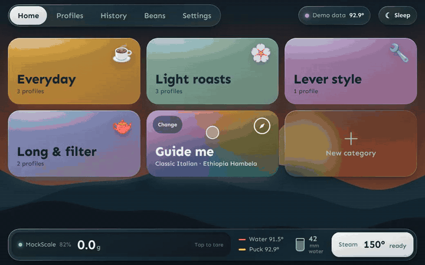

[Watch the full walkthrough (MP4)](docs/walkthrough.mp4)

- **Categories → profile → bag → Start shot.** Group profiles into categories you make yourself. Each profile tile can show a little graph of its last shot or its plan.
- **Dial-in per bag.** Grind, dose, yield and temperature are remembered for every bag and profile you use together, and carried over when you open a new bag of the same coffee. "Don't track" brews a freezer dose or a one-off without touching any bag.
- **Guide me: your coffee, made by anyone at home.** Set up your routine once, and your partner, flatmate or guest can make your coffee the way you do without asking: it loads your profile, coffee and dial-in on the machine and walks them through every step, from weighing the beans to rinsing the group. It follows the scale and the machine (weighing to the gram, starting the shot, flushing, steaming), so they can't get lost. Start from a preset (Simple, WDT and puck screen, Milk drinks), then reword the steps for your kit, reorder them, add your own with a timer or a photo of your actual grinder or tamper, and share a set of steps by copying it as text.
- **Live shot view.** Car-style dials for flow, pressure and temperatures beside the graph; the target weight as a bold line.
- **Lands on your target weight.** Coffee keeps dripping after the pump stops, so the skin learns from your shots how much still drips in (part fixed, part following the flow) and gives every profile its own stop-early setting, put on the machine with the profile. Leave it to tune itself after every shot, or pick values yourself.
- **History.** Touch the graph to read every value, rate and note shots, brew one again with the same settings, upload to Visualizer.
- **Beans.** Coffees with photos (the card takes its colour from the photo), bags that count down as you brew.
- **Steam and hot water at hand.** The bottom bar shows the scale, temperatures and water tank, with steam and hot water buttons to change temperature, amount and flow, or stop hot water by the scale.
- **Looks.** Frosted glass over your own background photo, a photo screensaver with a clock, and a panel colour to taste.
- **Every setting in one place.** The machine, scale, sleep and wake times, tablet charging and Decaid itself, in plain words, with tabs down the side.
- **New profiles from anywhere.** Start from scratch, a Visualizer share code or a .json file.
- **Updates itself.** Each time the machine wakes it checks for a newer version and shows a glowing Update button when one is ready.

Beans, bags and shots use Decaid's own APIs, so they show up in other skins and in shot history.

## Tour

All pictures are taken from the built-in demo mode (`?mock=1`), so the machine, scale, profiles and beans are simulated.

### Pick, dial in, brew

| | |
|:--|:--|
| 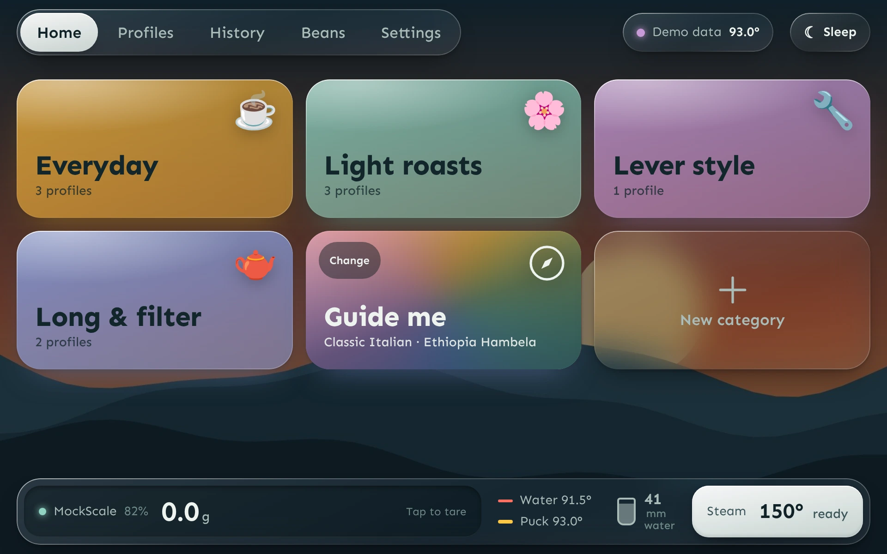 | 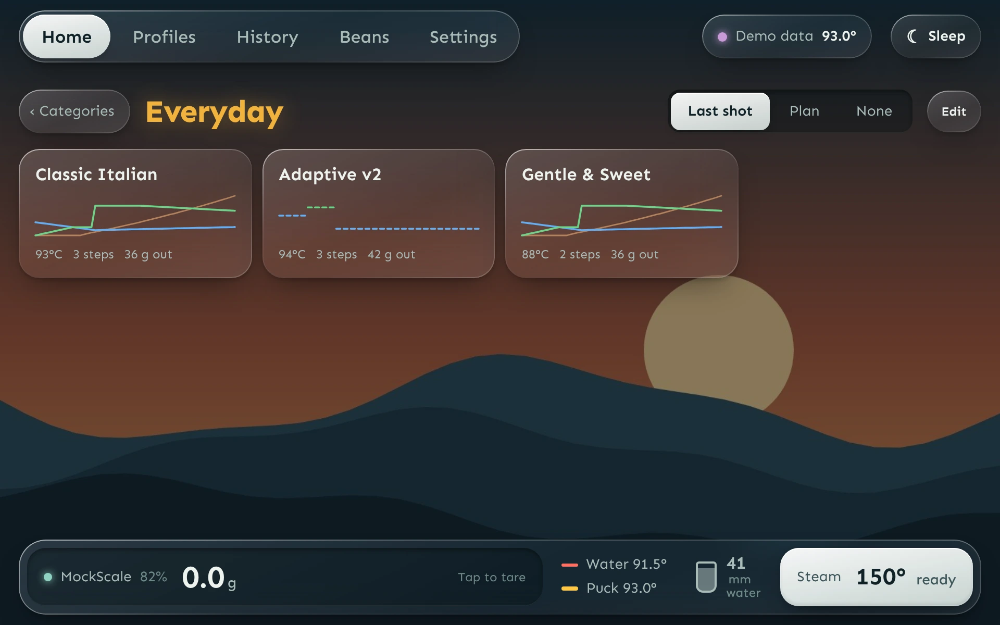 |
| **Home.** A tile per category, and Guide me. | **Profiles in a category.** Each tile shows its last shot or its plan. Hold one to edit it. |
| 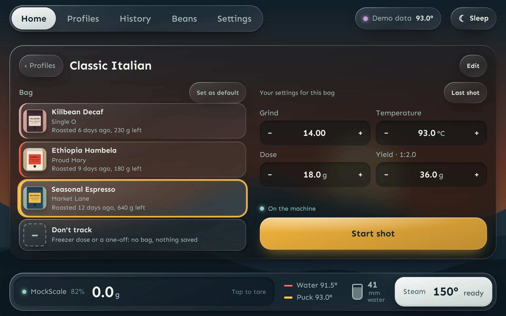 | 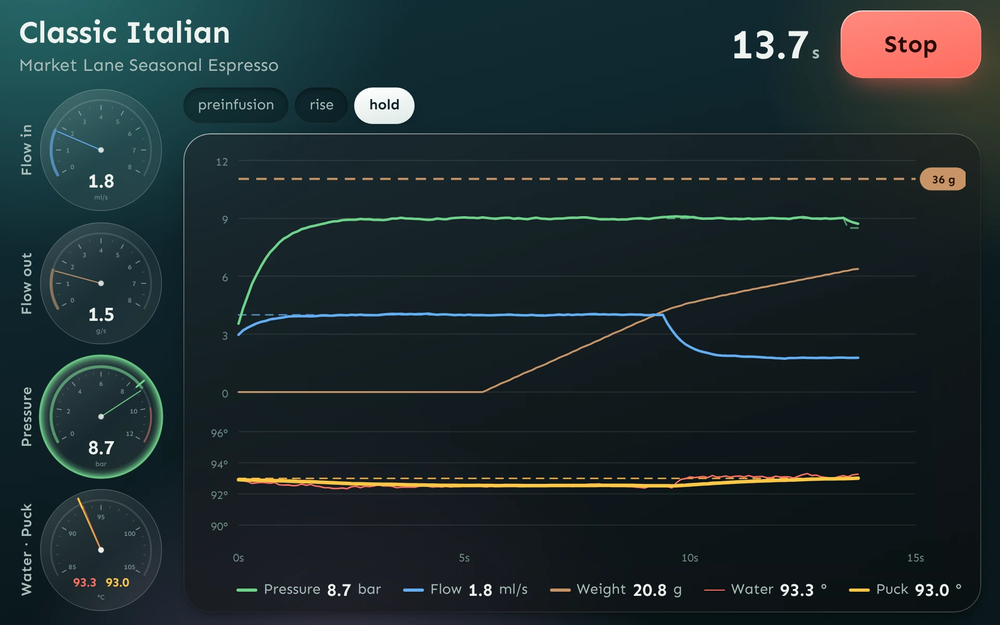 |
| **Brew panel.** Pick a bag, then grind, dose, yield and temperature. Dial-in is remembered per bag and profile. | **Live shot.** Dials for flow, pressure and temperatures beside the graph, with the target weight as a dashed line. |

### History and beans

| | |
|:--|:--|
| 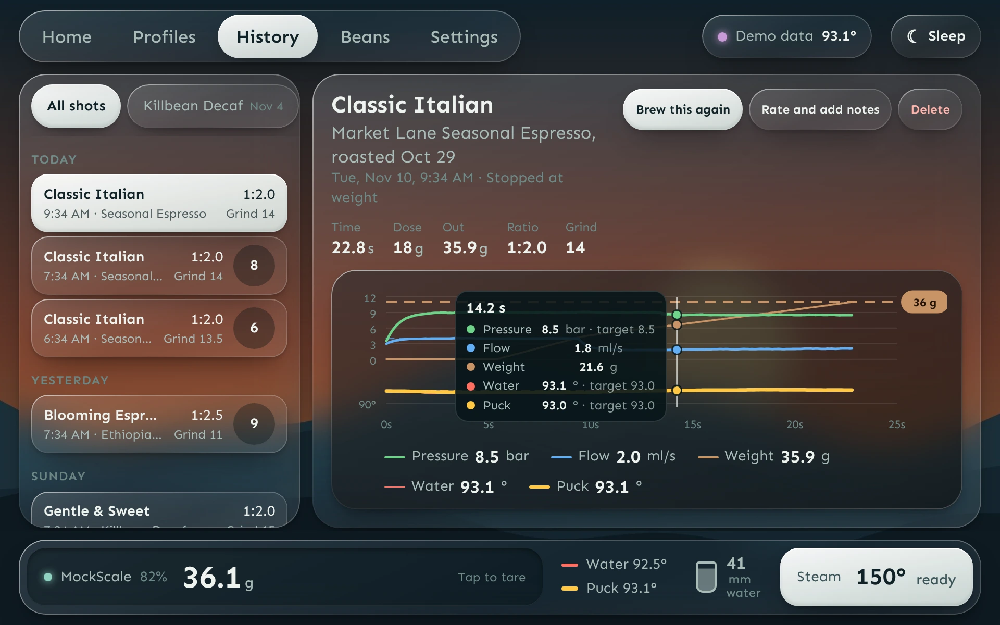 | 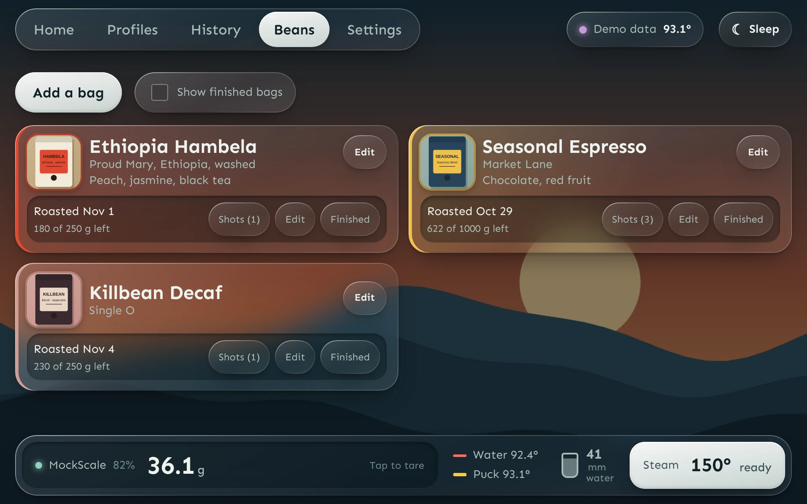 |
| **History.** Touch or drag on the graph to read every value. Rate, add notes or brew it again. | **Beans.** Coffees with photos and bags that count down as you brew. |

### Guide me

For everyone else in the house: you set the routine up once, they follow it step by step.

| | |
|:--|:--|
| 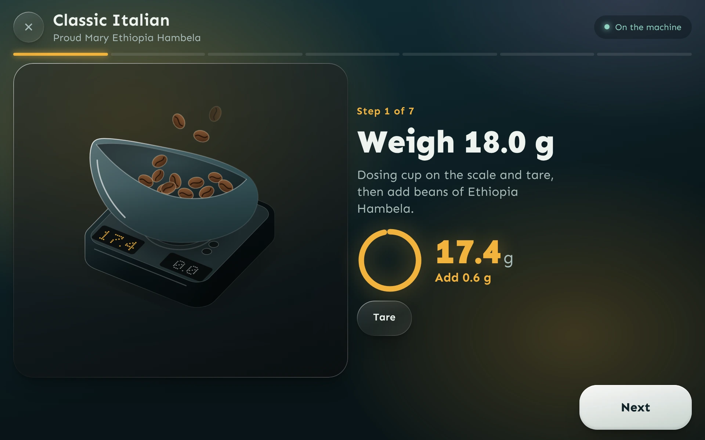 | 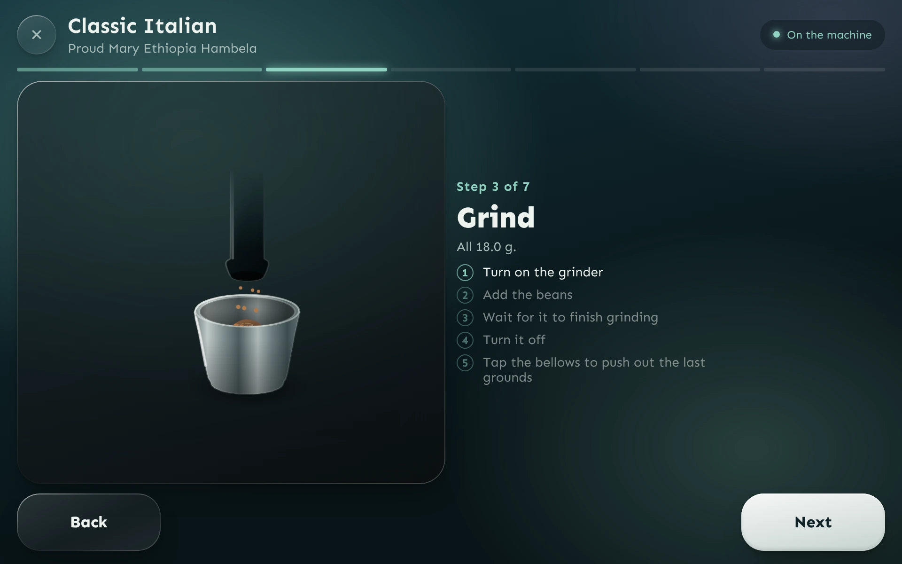 |
| **Weigh.** Follows the scale to the gram and says how much to add or take out. | **Grind.** Illustrated steps with checklists, so nothing is missed. |
| 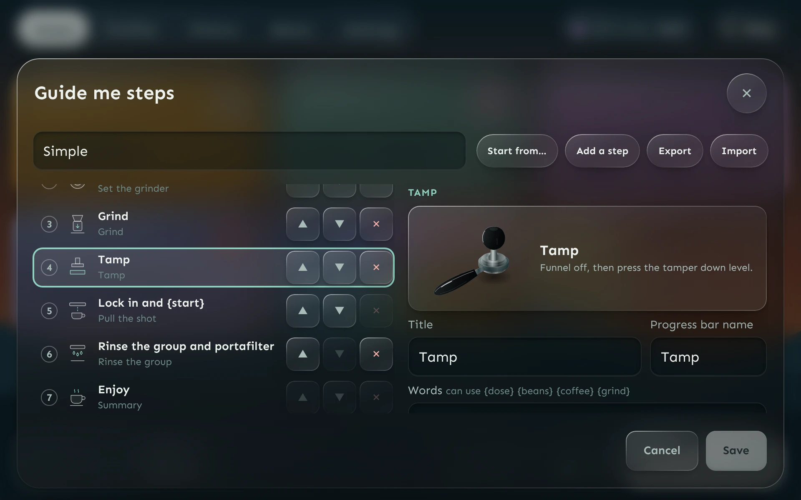 | 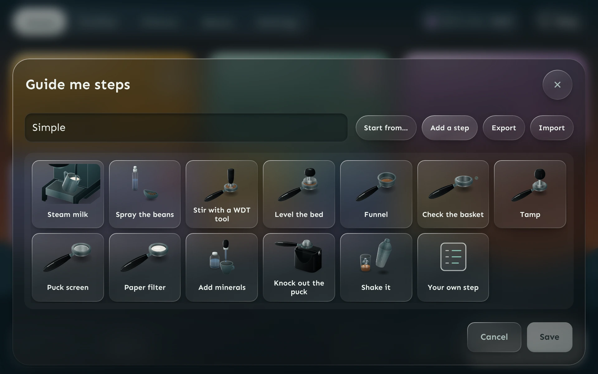 |
| **Steps editor.** Full screen: write each step for whoever will follow it, with a preview of what they'll see. Reorder, add photos of your own kit and timers. | **Add a step.** Pick from the library or write your own. |

### Profiles and settings

| | |
|:--|:--|
| 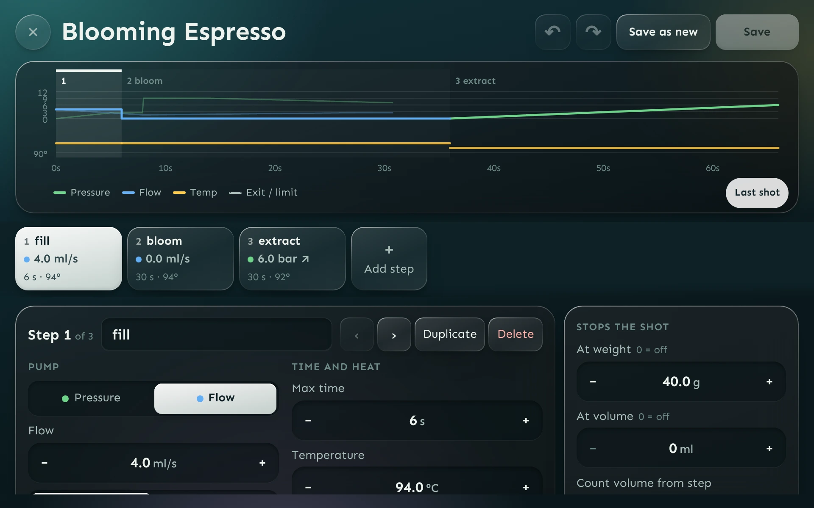 | 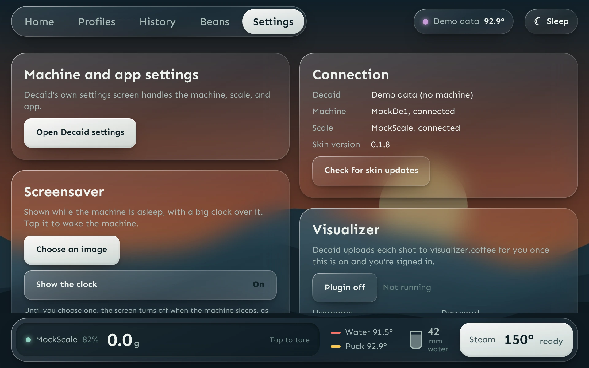 |
| **Profile editor.** Planned curve, every step setting, undo and redo. Start a new profile from scratch, a Visualizer share code or a .json file. | **Settings.** Tabs for the look, screensaver, machine, shots and scale (with stop-at-weight tuning per profile), sleep and wake, tablet, Visualizer and more. |

To retake the pictures and the video, run the dev server and `node scripts/capture-docs.cjs` (it needs Playwright and ffmpeg; see the comment at the top of the script).

## Install

You need [Decaid](https://github.com/decentespresso/decaid) on the tablet, connected to your DE1. The tablet also needs internet access for the install.

1. **Go to Decaid's launcher.** If another skin is open, leave it for the Decent dashboard (the launcher).
2. **Open Skins.** Tap **Skins** (the palette icon). This opens the Web Interface page.
3. **Install from GitHub.** Tap the cog at the top right, then **Install skin → GitHub Release**.
4. **Enter the repository.** Type `flimsybeets/flimsydecent` in **Repository** and leave **Asset name** empty. Tap **Install**. Decaid downloads the latest release and shows "Skin installed from GitHub".
5. **Choose it.** Pick **FlimsyDecent** in the skin list. Decaid keeps it as your skin from then on, also after a restart.
6. **Open it.** Tap **Go to skin**.

To get to the launcher later, use Decaid's own way back to the dashboard. Decaid shows a short navigation guide the first time a skin opens.

### Updates

FlimsyDecent checks for a newer version each time the machine wakes and shows a glowing **Update** button beside the machine status; tap it to reload into the new version. You can also check any time from **Settings → About → Check for skin updates**.

You can also update from Decaid: **Skins → cog → Check for updates** re-fetches every skin from where it was installed.

### Camera

The camera is used for coffee and step photos. The first time you tap **Take photo**, Decaid asks whether FlimsyDecent may use the camera. You can change your answer later on the Skins page.

### Other ways to install

**ZIP file.** Download `flimsydecent-<version>.zip` from [Releases](https://github.com/flimsybeets/flimsydecent/releases) onto the tablet. Then use **Skins → cog → Install skin → ZIP file**. A ZIP install is selected and opened straight away. It has no source to update from, so install a newer zip the same way.

**From your laptop over Wi-Fi** (for development):

```bash
npm install
npm run install:tablet -- 192.168.1.50   # your tablet's IP
```

Or run `npm run package` and install `release/flimsydecent-<version>.zip` with Install skin → ZIP file.

## Develop

```bash
npm install
npm run dev
```

- `http://localhost:5173/?mock=1` runs on simulated data, no machine needed.
- `http://localhost:5173/?gateway=192.168.1.50` talks to Decaid on your tablet.
- Open `http://<laptop IP>:5173/?gateway=localhost` on the tablet itself to try it with your fingers.

`npm run check` type-checks and `npm test` runs the unit tests. `npm run art:generic` regenerates the Guide me illustrations.

## Release

Bump `version` in `package.json` and merge to `main`: GitHub Actions tags it, builds the zip and publishes the release.

## License

AGPL-3.0. See [LICENSE](LICENSE).
